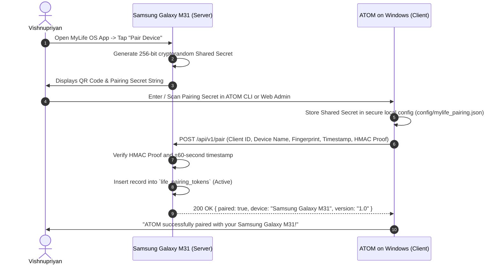

# 🔐 MyLife OS Local Network Pairing & Cryptographic Security Specification

> **Secure Local-First Communication Contract**  
> **Host Server**: Samsung Galaxy M31 (Port 8765)  
> **Client**: ATOM Windows / Local Surfaces  
> **Transport**: Private Local Wi-Fi (Zero Cloud Intermediaries)

---

## 1. Threat Model & Security Invariants

MyLife OS stores the user's complete personal life records (finances, health, documents, locations, journal entries). It must be protected against:
- Unauthorized devices on the same local Wi-Fi (smart TVs, guest phones, IoT devices).
- Packet replay attacks.
- Accidental exposure to public networks.

### Security Invariants
1. **Binding to Local Subnet**: The embedded phone server listens strictly on local private IP ranges (`192.168.x.x`, `10.x.x.x`, `172.16-31.x.x`) and `127.0.0.1`. It never binds to public interfaces.
2. **Mutual Pairing**: ATOM Windows cannot read or modify any data without completing an initial cryptographic pairing handshake.
3. **Per-Request HMAC Signature**: Every HTTP request is signed with HMAC-SHA256 and verified by the phone server before touching SQLite.
4. **Anti-Replay Window**: Timestamps must fall within a ±60-second window to prevent replaying intercepted requests.
5. **No Cleartext Sensitive Data in Headers or Logs**: Passwords, tokens, and raw keys are never placed in URLs or server query logs.

---

## 2. Pairing Workflow (Initial Device Pairing)



### QR Code Payload Schema
```json
{
  "version": 1,
  "service": "mylife-os",
  "device_id": "M31-SM-M315F",
  "port": 8765,
  "host_hint": "192.168.29.91",
  "mdns_name": "mylife-os.local",
  "shared_secret": "a4f89b6c12e841209b552341908234ab89c01123456789abcdef0123456789ab"
}
```

### Pairing Proof
The public `/api/v1/pair` route is a public handshake only; it does not bypass proof validation. The request body must include `client_id`, `device_name`, `client_fingerprint`, `timestamp` (Unix seconds), and `signature`. The signature is lowercase or uppercase hexadecimal HMAC-SHA256 over:

```text
client_id + "\n" + device_name + "\n" + client_fingerprint + "\n" + timestamp
```

The phone accepts proofs only within the same ±60-second window as signed API calls. The server registers the client only after proof verification. A failed proof returns HTTP 401 and does not change paired-client state.

The server binds to one discovered RFC1918 IPv4 address. If none is available, it binds to `127.0.0.1`; it never uses the wildcard `0.0.0.0` address. Protected routes also require a completed pairing and an `X-MyLife-Client` value matching the registered client, in addition to the per-request HMAC headers.

### AI Access and Local Retention
The ATOM CLI exposes read-only MyLife status, summary, and module queries to its AI tool loop. Before each read, a trusted CLI callback asks the user whether this personal data may be supplied to the configured AI provider; provider failover may also receive it. Approval is not accepted from model-generated tool arguments. A successful MyLife read is limited to one per turn, is not added to cross-model self-learning or persistent chat/tool logs, and cannot be followed by another tool in that turn. Other clients do not register this tool unless they provide an equivalent trusted approval flow.

---

## 3. Per-Request Authentication Protocol

Every subsequent HTTP request from ATOM Windows to the phone must provide 3 custom security headers:

```http
GET /api/v1/finance/summary HTTP/1.1
Host: mylife-os.local:8765
X-MyLife-Client: ATOM-WINDOWS
X-MyLife-Timestamp: 1793912400
X-MyLife-Signature: 8f49b1a030018f6d7c71289551c91bc4a1320efb069d584323e12019808381bf
Content-Type: application/json
```

### Signature Computation Algorithm
```
Signature = HMAC_SHA256(
    Key: SharedSecret,
    Message: HTTP_METHOD + "\n" + REQUEST_URI + "\n" + TIMESTAMP + "\n" + REQUEST_BODY_SHA256
)
```
Where:
- `HTTP_METHOD`: Uppercase string (`GET`, `POST`, `PUT`, `DELETE`).
- `REQUEST_URI`: Exact path with query parameters (`/api/v1/finance/summary`).
- `TIMESTAMP`: Epoch seconds (integer).
- `REQUEST_BODY_SHA256`: Hexadecimal SHA-256 hash of the JSON payload (or empty string hash `e3b0c44298fc1c149afbf4c8996fb92427ae41e4649b934ca495991b7852b855` for bodyless GET/DELETE requests).

---

## 4. Local Service Discovery (mDNS & IP Fallback)

To eliminate the need for manual IP configuration whenever the home Wi-Fi router reassigns DHCP leases:

1. **Primary: mDNS (Multicast DNS)**:
   - The phone server advertises service type `_mylife-os._tcp` on port `8765`.
   - ATOM attempts resolution via `http://mylife-os.local:8765`.
2. **Secondary: Last-Known IP Fallback**:
   - If mDNS resolution fails (e.g. router multicast filtering), ATOM reads the cached IP from `config/mylife_connection.json` and issues a probe: `GET http://<cached_ip>:8765/api/v1/ping`.
3. **Tertiary: Local Subnet Discovery**:
   - If the cached IP is unresponsive, ATOM scans the local `/24` subnet for the open port `8765` and checks the `/api/v1/ping` signature response. Once discovered, the new IP is cached automatically.

---

## 5. Anti-Tampering & Audit Trail

Every mutating action (`CREATE`, `UPDATE`, `DELETE`, `EXPORT`) is written to `life_audit_logs` inside the phone's encrypted SQLite database:
- `actor`: `ATOM_WINDOWS_API` vs `PHONE_UI`.
- `module_id`: Target module.
- `action`: Operation performed.
- `details`: Redacted summary of mutated fields.

This guarantees that the user has complete visibility on the phone screen of every request made by ATOM.

